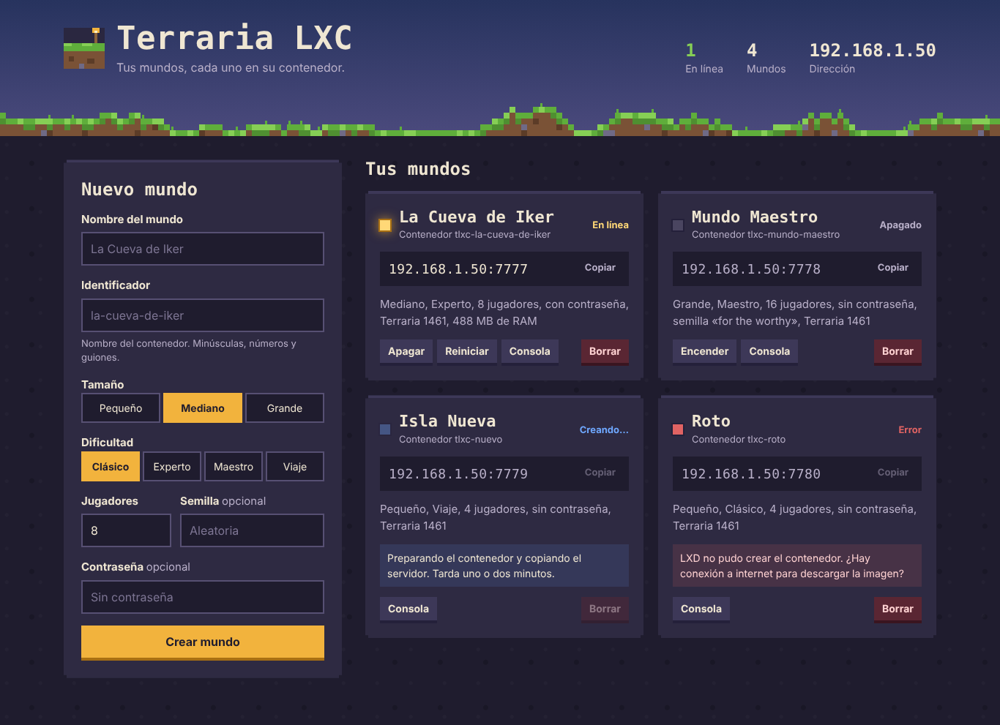

# Terraria LXC Manager

**Panel web para crear y administrar servidores de Terraria, cada uno aislado en su propio contenedor LXD.**

[](LICENSE)
[](https://canonical.com/lxd)
[](https://php.net)
[](https://ubuntu.com)



## Qué hace

- **Crea un mundo en un clic**: nombre, tamaño, dificultad (Clásico, Experto, Maestro o Viaje), jugadores, semilla y contraseña.
- **Cada servidor va en su propio contenedor** con límites de RAM y CPU, así uno no puede tumbar a los demás.
- **Le asigna un puerto libre** de forma automática (7777, 7778…) y muestra la dirección lista para copiar.
- **Muestra el estado en vivo**: creando, generando mundo, en línea o apagado, y la RAM que usa cada uno.
- **Consola en el navegador**: puedes ver lo que pasa en el servidor y mandarle comandos (`save`, `playing`, `say`…).
- **Guarda el mundo al apagar** el servidor y lo vuelve a arrancar solo cuando se reinicia la máquina.
- **El panel está protegido** con usuario y contraseña, y la web no tiene acceso directo a LXD.

## Instalación

Requisitos: **Ubuntu 22.04 o 24.04** (x86_64), física o virtual, con acceso a internet. Con 2 GB de RAM por servidor vas sobrado.

```bash
git clone https://github.com/ikeersf/terraria-lxc.git
cd terraria-lxc
sudo ./install.sh
```

Al terminar, el instalador te muestra la dirección del panel, el usuario y la contraseña. La contraseña también se guarda en `/root/terraria-lxc-credenciales.txt`.

El instalador:

1. Instala Apache, la versión de PHP que trae tu Ubuntu (8.1 o 8.3), `jq`, `curl` y `unzip`.
2. Instala e inicializa LXD si no lo estaba.
3. Copia el panel a `/opt/terraria-lxc` y el gestor a `/usr/local/sbin/terraria-lxc`.
4. Da a Apache permiso para ejecutar **solo** el gestor.
5. Crea el usuario del panel.
6. Configura un sitio de Apache dedicado.
7. Descarga el servidor de Terraria, para que crear el primer mundo sea rápido.

Puedes volver a ejecutarlo cuando quieras, también para actualizar después de un `git pull`. Conserva tu configuración, tus usuarios y tus mundos.

Si quieres elegir tú las credenciales:

```bash
sudo ADMIN_USER=iker ADMIN_PASS='una-contraseña-larga' ./install.sh
```

## Conectarse desde el juego

En Terraria: **Multijugador → Unirse por IP**, y pon la IP y el puerto que salen en la tarjeta del mundo (por ejemplo `192.168.1.50:7777`).

La primera vez el mundo tarda uno o dos minutos en generarse. La tarjeta pasa de *Generando mundo…* a *En línea* cuando ya se puede entrar.

Si quieres jugar desde fuera de tu red, abre en el router el rango de puertos `7777-7876/tcp` hacia la máquina.

## Configuración

Todo está en `/etc/terraria-lxc/terraria-lxc.conf`:

| Opción | Por defecto | Para qué sirve |
|---|---|---|
| `TERRARIA_VERSION` | `1461` | Versión del servidor (1.4.6.1). Tiene que coincidir con la del juego de los jugadores. |
| `IMAGE` | `ubuntu:24.04` | Imagen base de los contenedores. |
| `PORT_MIN` / `PORT_MAX` | `7777` / `7876` | Rango de puertos que se reparten. |
| `MAX_SERVERS` | `10` | Número máximo de mundos. |
| `MEMORY_LIMIT` / `CPU_LIMIT` | `2GiB` / `2` | Límites de cada contenedor. |
| `PUBLIC_HOST` | vacío | IP o dominio que se muestra a los jugadores. Vacío = la IP con la que abres el panel. |

Cuando salga una versión nueva de Terraria, cambia `TERRARIA_VERSION` y ejecuta `sudo terraria-lxc prepare`. Los mundos nuevos usarán esa versión.

## Uso desde la terminal

El panel usa el mismo gestor que puedes usar tú a mano:

```bash
sudo terraria-lxc list                  # lista los mundos en JSON
sudo terraria-lxc stop la-cueva         # apaga (y guarda) un mundo
sudo terraria-lxc start la-cueva
sudo terraria-lxc console la-cueva      # últimas líneas de la consola
sudo terraria-lxc send la-cueva "say Hola"
sudo terraria-lxc delete la-cueva
```

Para entrar en la consola real del servidor:

```bash
lxc exec tlxc-la-cueva -- runuser -u terraria -- tmux -L terraria attach -t terraria
# Para salir sin apagarlo: Ctrl+B y después D
```

Los mundos están dentro de cada contenedor, en `/opt/terraria/worlds/world.wld`. Para sacar una copia:

```bash
lxc file pull tlxc-la-cueva/opt/terraria/worlds/world.wld ./la-cueva.wld
```

## Cómo funciona

```
Navegador ──► Apache + PHP (web/api.php)
                 │  sudo, solo este programa
                 ▼
          /usr/local/sbin/terraria-lxc   ← valida todo lo que recibe
                 │
                 ▼
               LXD ──► contenedor tlxc-<nombre>
                         └─ systemd: terraria.service
                              └─ tmux ─ TerrariaServer (puerto 7777)
                 proxy LXD: 0.0.0.0:<puerto público> ──► 127.0.0.1:7777
```

| Ruta en el repo | Qué es |
|---|---|
| `install.sh` / `uninstall.sh` | Instalación y desinstalación. |
| `bin/terraria-lxc` | El gestor: crea, enciende, apaga, borra y lista contenedores. |
| `container/setup.sh` | Se ejecuta dentro de cada contenedor nuevo y deja Terraria como servicio. |
| `web/` | El panel: `index.html`, `assets/` y la API `api.php`. |
| `etc/terraria-lxc.conf` | Configuración por defecto. |

Los datos de cada mundo (sin exponerlos en la web) se guardan en `/var/lib/terraria-lxc/servers/` y el servidor descargado, en `/var/lib/terraria-lxc/cache/`.

### Seguridad

- Apache solo puede ejecutar `terraria-lxc` con sudo, nunca `lxc` directamente, y el gestor valida cada campo.
- El gestor solo toca contenedores con el prefijo `tlxc-`, así que no puede afectar a otros contenedores de la máquina.
- El panel pide usuario y contraseña, y las acciones se protegen contra peticiones desde otras webs (CSRF).
- Las contraseñas de los mundos no se envían nunca al navegador.

> La autenticación básica viaja sin cifrar por HTTP. Si vas a abrir el panel a internet, ponlo detrás de HTTPS (por ejemplo con `certbot --apache`).

## Problemas comunes

**La creación se queda en error al copiar archivos o configurar el servicio.** Abre la consola del mundo para ver el registro. Lo más común es que los contenedores no tengan internet:

```bash
lxc launch ubuntu:24.04 prueba && sleep 10 && lxc exec prueba -- ping -c2 archive.ubuntu.com; lxc delete -f prueba
```

Si tienes Docker instalado, su firewall bloquea la red de LXD. Solución:

```bash
sudo iptables -I DOCKER-USER -i lxdbr0 -j ACCEPT
sudo iptables -I DOCKER-USER -o lxdbr0 -m conntrack --ctstate RELATED,ESTABLISHED -j ACCEPT
```

**"No se pudo descargar el servidor de Terraria".** La versión de `TERRARIA_VERSION` no existe. Consulta la versión actual en la [wiki de Terraria](https://terraria.wiki.gg/wiki/Dedicated_Server).

**Los jugadores no pueden entrar.** Comprueba que su versión del juego coincide con `TERRARIA_VERSION` y que el firewall deja pasar el puerto (`sudo ufw allow 7777:7876/tcp`).

**"Apache no tiene permiso para usar el gestor".** Vuelve a ejecutar `sudo ./install.sh`.

## Desinstalar

```bash
sudo ./uninstall.sh          # quita el panel y conserva los mundos
sudo ./uninstall.sh --purge  # borra también todos los contenedores tlxc-* y sus datos
```

## Licencia

[GPL-3.0](LICENSE). Terraria es una marca de Re-Logic. Este proyecto no está afiliado a Re-Logic: descarga el servidor dedicado oficial desde terraria.org.
